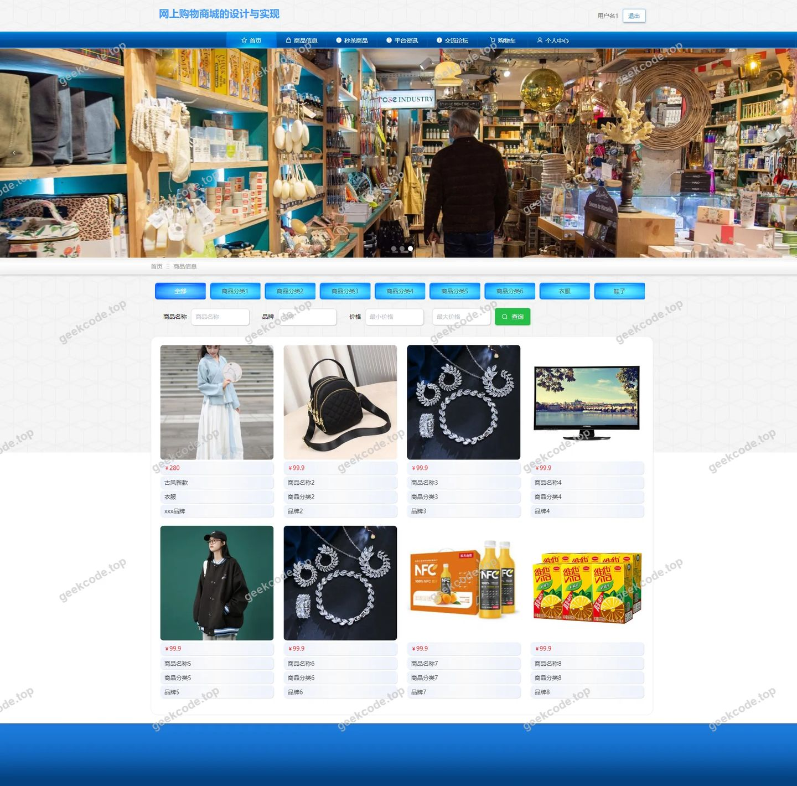
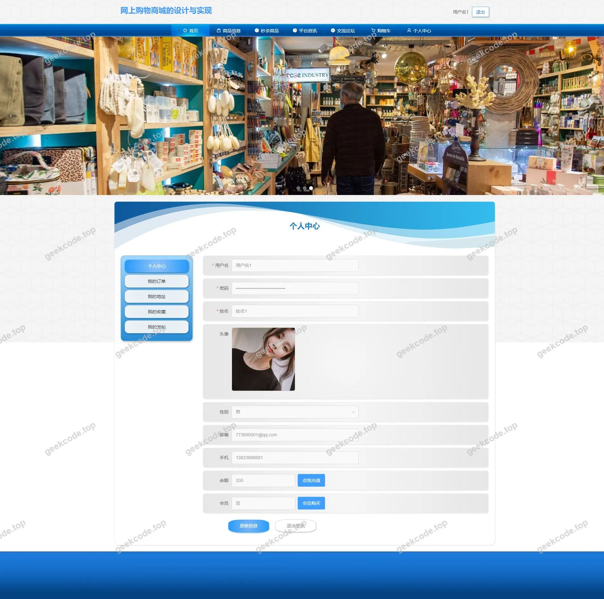
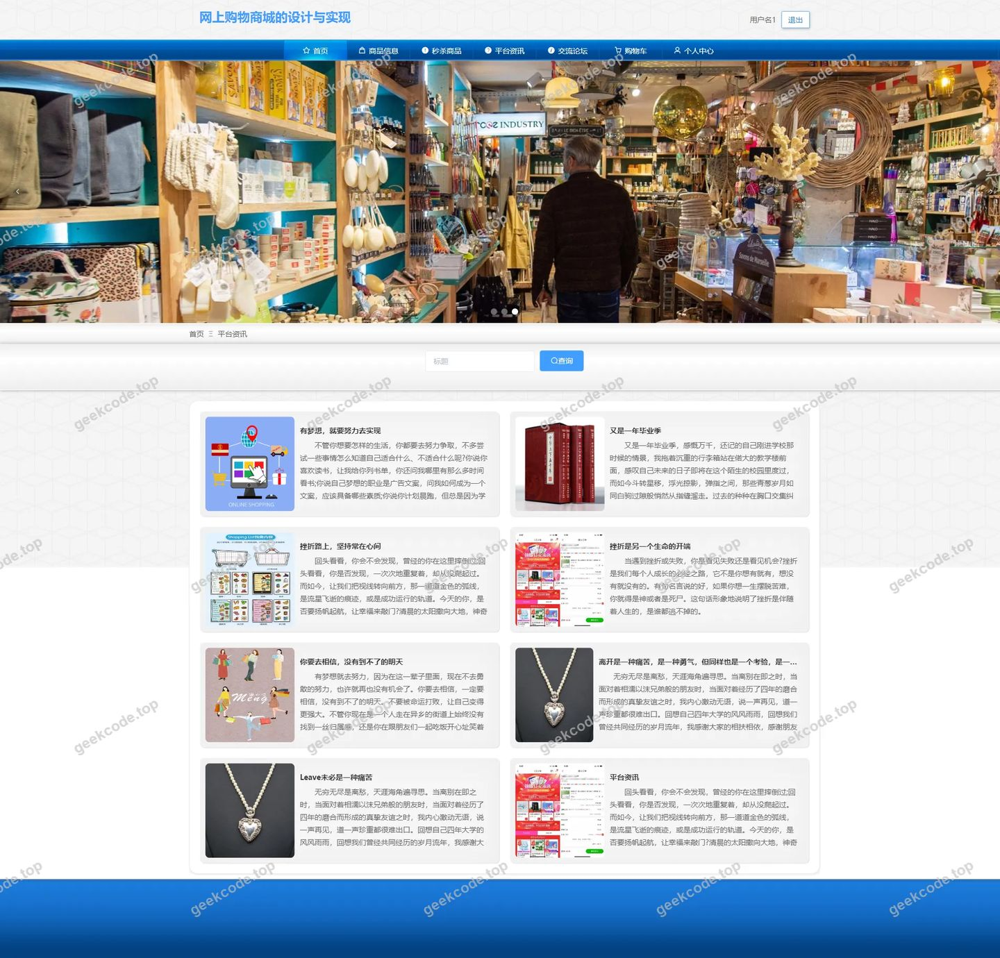
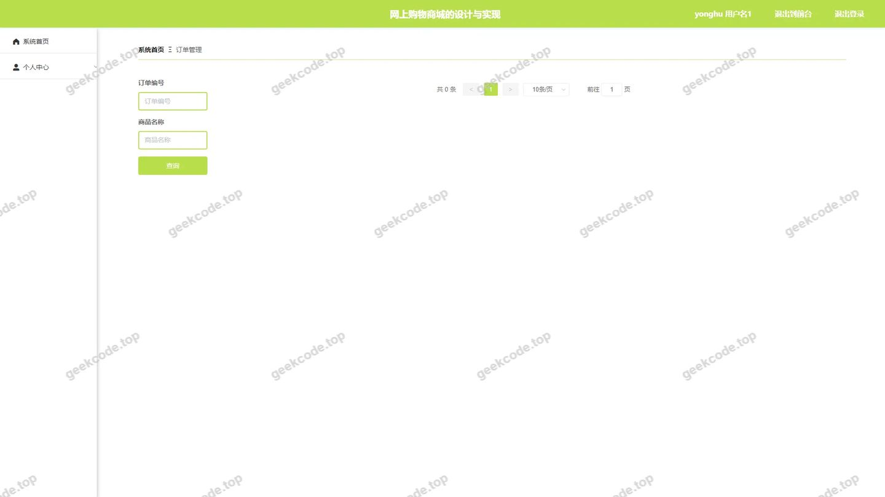
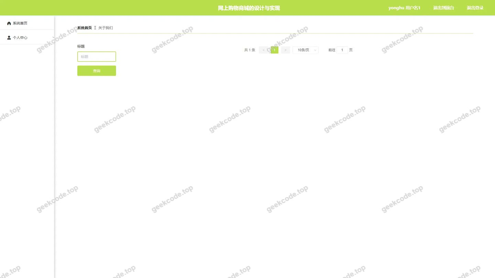
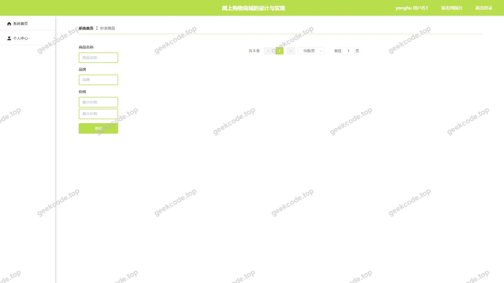
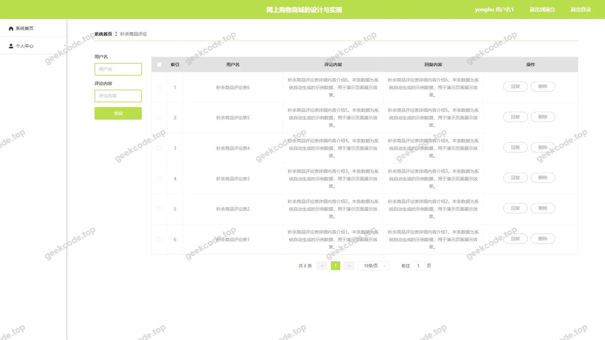
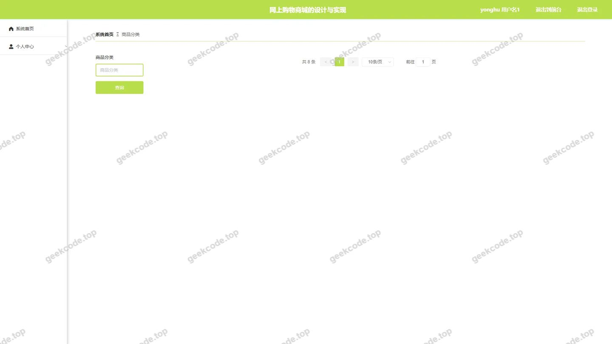
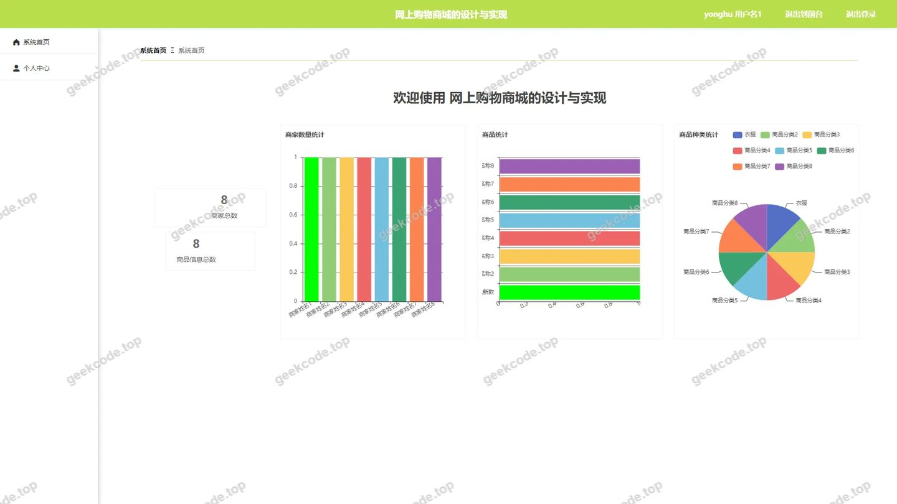
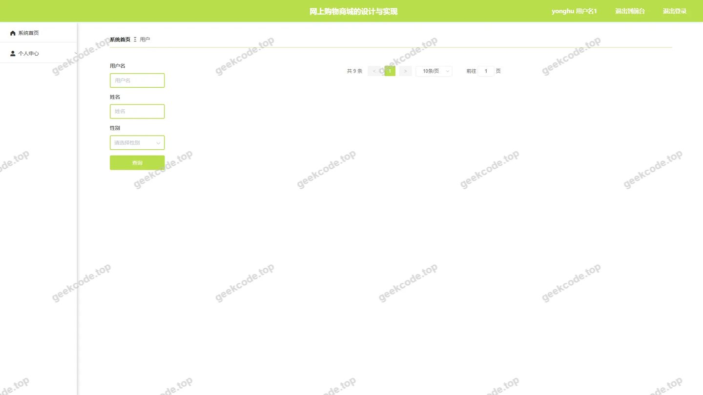

# 网上购物商城的设计与实现

> 🎓 **计算机毕业设计 · 网上购物商城的设计与实现**
>
> 本仓库只放**项目介绍 + 运行截图**（截图是站点带水印的原图，存在仓库 `images/` 里）。
>
> 👉 **完整可运行源码 / 数据库脚本 / 部署文档：[点我获取](https://geekcode.top/archives/%E7%BD%91%E4%B8%8A%E8%B4%AD%E7%89%A9%E5%95%86%E5%9F%8E%E7%9A%84%E8%AE%BE%E8%AE%A1%E4%B8%8E%E5%AE%9E%E7%8E%B0?utm_source=github)**
>
> 💬 咨询微信：**ir9372**　|　🌐 更多项目：[极客代码 geekcode.top](https://geekcode.top/?utm_source=github)
>
> 📌 项目详情页：<https://geekcode.top/archives/%E7%BD%91%E4%B8%8A%E8%B4%AD%E7%89%A9%E5%95%86%E5%9F%8E%E7%9A%84%E8%AE%BE%E8%AE%A1%E4%B8%8E%E5%AE%9E%E7%8E%B0?utm_source=github>

<table><td width="230" align="center"> <b>扫码加微信 ir9372</b></td><td valign="middle">📦 源码 = 项目介绍 + 全部运行截图 + 数据库 + 部署文档 👉 点上方任意截图，直接跳到 <b>极客代码 geekcode.top</b> 详情页</td></table>

---

<h1>网上购物商城的设计与实现</h1>
<h2>项目概述</h2>

本项目旨在设计并实现一个基于 Web 的网上购物商城系统，解决传统电商交易流程繁琐、商品展示单一及用户互动性不足的问题。系统采用前后端分离架构，核心功能涵盖商品浏览、分类检索、限时秒杀、订单管理、商家入驻及社区交流等模块。适用人群包括普通消费者、平台管理员及入驻商家。技术架构上，后端基于 Spring Boot 框架结合 MyBatis-Plus 进行数据持久化操作，使用 Apache Shiro 实现安全权限控制；前端采用 Vue 框架构建响应式界面。通过整合资讯发布与论坛交流功能，本项目不仅实现了基础的电商交易闭环，还增强了用户粘性与平台活跃度，适用于中小型垂直领域电商平台的快速搭建与运营场景。

<h2>技术架构</h2>
<h3>总体架构</h3>

系统采用经典的 MVC（Model-View-Controller）分层架构模式，具体表现为：

<ol>
<li><strong>表现层 (View)</strong>：由 Vue.js 构建的前端应用负责页面渲染与交互逻辑，通过 HTTP/HTTPS 协议向后端发起请求。</li>
<li><strong>控制层 (Controller)</strong>：Spring Boot 提供 RESTful API 接口，处理业务逻辑分发。主要 Controller 包括 <code>AboutusController</code>（关于我们）、<code>AddressController</code>（地址管理）、<code>CartController</code>（购物车）、<code>CommonController</code>（通用接口）、<code>ConfigController</code>（配置管理）、<code>DiscussmiaoshashangpinController</code>（秒杀评论）、<code>DiscussshangpinxinxiController</code>（商品评论）、<code>FileController</code>（文件上传）、<code>ForumController</code>（论坛）、<code>MiaoshashangpinController</code>（秒杀商品）、<code>NewsController</code>（资讯）、<code>OrdersController</code>（订单）。</li>
<li><strong>服务层 (Service)</strong>：封装具体的业务规则，如秒杀库存扣减、订单状态流转、权限验证等。</li>
<li><strong>数据访问层 (DAO/Mapper)</strong>：利用 MyBatis-Plus 简化 CRUD 操作，通过注解或 XML 映射文件定义 SQL 语句，直接操作 MySQL 数据库。</li>
</ol>
<h3>核心技术选型理由</h3>
<ul>
<li><strong>Spring Boot</strong>：作为微服务基础框架，其自动配置特性大幅减少了开发者的配置负担，内置 Tomcat 容器便于快速部署。</li>
<li><strong>MyBatis-Plus</strong>：在 MyBatis 基础上提供了更强大的 CRUD 功能和分页插件，显著提升了复杂查询的开发效率，同时保持了 SQL 的可控性。</li>
<li><strong>Apache Shiro</strong>：轻量级的安全框架，用于实现身份认证（Authentication）和授权（Authorization），有效保护后台管理接口及敏感用户数据的安全。</li>
<li><strong>MySQL</strong>：成熟的关系型数据库，支持事务处理，适合存储订单、用户信息等结构化数据。</li>
</ul>
<h3>数据库设计要点</h3>

数据库主要包含以下核心实体表：

<ul>
<li><strong>用户相关</strong>：<code>yonghu</code>（用户信息）、<code>shangjia</code>（商家信息）。</li>
<li><strong>商品相关</strong>：<code>shangpinxinxi</code>（商品信息）、<code>shangpinfenlei</code>（商品分类）、<code>miaoshashangpin</code>（秒杀商品）。</li>
<li><strong>交易相关</strong>：<code>orders</code>（订单记录）、<code>address</code>（收货地址）、<code>cart</code>（购物车）。</li>
<li><strong>内容与互动</strong>：<code>news</code>（平台资讯）、<code>aboutus</code>（关于我们）、<code>forum</code>（交流论坛）、<code>discuss_shangpin</code>（商品评论）、<code>discuss_miaosha</code>（秒杀评论）。</li>
<li><strong>系统配置</strong>：<code>config</code>（系统参数配置）。</li>
</ul>
<h2>功能模块</h2>
<h3>前台用户端</h3>

前台面向普通消费者，提供完整的购物体验与信息获取渠道：

<ol>
<li><strong>首页展示</strong>：聚合展示最新商品、热门资讯及轮播广告，引导用户进入各功能区。</li>
<li><strong>商品信息浏览</strong>：支持按分类查看商品列表，展示商品详情、价格、库存及用户评价。</li>
<li><strong>秒杀专区</strong>：独立入口展示限时抢购商品，支持倒计时显示与即时下单，体现高并发场景下的业务逻辑。</li>
<li><strong>平台资讯</strong>：阅读发布的新闻公告、活动预告等内容，了解平台动态。</li>
<li><strong>交流论坛</strong>：用户可发帖讨论商品体验或购物心得，增强社区氛围。</li>
<li><strong>个人中心</strong>：虽然菜单未显式列出，但根据截图和功能逻辑，用户可进行收藏管理（收藏列表）、查看订单状态及维护个人信息。</li>
</ol>
<h3>后台管理端</h3>

后台面向管理员，提供全面的系统运维与业务管理能力：

<ol>
<li><strong>登录与安全</strong>：通过 Shiro 进行身份验证，确保只有授权人员可访问管理系统。</li>
<li><strong>商品管理</strong>：</li>
</ol>
<ul>
<li><strong>商品信息 (<code>/shangpinxinxi</code>)</strong>：增删改查商品基本信息、图片及描述。</li>
<li><strong>商品分类 (<code>/shangpinfenlei</code>)</strong>：维护商品类别树状结构。</li>
<li><strong>秒杀商品 (<code>/miaoshashangpin</code>)</strong>：配置秒杀活动时间、数量及价格策略。</li>
</ul>
<ol start="3">
<li><strong>订单管理 (<code>/orders/:status</code>)</strong>：查看所有订单，支持按状态筛选（如待支付、已发货、已完成），处理退款或异常订单。</li>
<li><strong>用户与商家管理</strong>：</li>
</ol>
<ul>
<li><strong>用户管理 (<code>/yonghu</code>)</strong>：查看注册用户信息，禁用违规账号。</li>
<li><strong>商家管理 (<code>/shangjia</code>)</strong>：审核商家入驻申请，管理商家资质。</li>
</ul>
<ol start="5">
<li><strong>内容管理</strong>：</li>
</ol>
<ul>
<li><strong>平台资讯 (<code>/news</code>)</strong>：发布和管理新闻公告。</li>
<li><strong>关于我们 (<code>/aboutus</code>)</strong>：编辑公司介绍及服务条款。</li>
<li><strong>论坛管理 (<code>/forum</code>)</strong>：监控论坛帖子，删除违规内容。</li>
<li><strong>评论管理</strong>：分别管理普通商品评论 (<code>/discussshangpinxinxi</code>) 和秒杀商品评论 (<code>/discussmiaoshashangpin</code>)，屏蔽不良言论。</li>
</ul>
<ol start="6">
<li><strong>系统配置 (<code>/config</code>)</strong>：修改网站名称、Logo、联系方式等全局参数。</li>
</ol>
<h2>用户角色与权限</h2>

根据代码中的 Controller 命名及 Shiro 安全框架的应用，系统主要涉及两类核心角色：

<h3>1. 普通用户 (Customer/User)</h3>
<ul>
<li><strong>注册与登录</strong>：拥有独立的账号体系，可通过手机号或邮箱注册。</li>
<li><strong>浏览与搜索</strong>：访问所有公开的商品、资讯和论坛内容。</li>
<li><strong>交易行为</strong>：将商品加入购物车、提交订单、参与秒杀活动。</li>
<li><strong>个人管理</strong>：查看历史订单、管理收货地址、收藏感兴趣的商品。</li>
<li><strong>互动权限</strong>：在论坛发帖、对已购买或浏览的商品发表评价。</li>
</ul>
<h3>2. 管理员 (Admin)</h3>
<ul>
<li><strong>最高权限</strong>：拥有系统所有后台路由 (<code>/news</code>, <code>/aboutus</code>, <code>/discuss...</code>, <code>/yonghu</code>, <code>/shangpin...</code>, <code>/orders</code>, <code>/config</code>, <code>/shangjia</code>, <code>/forum</code>) 的访问权。</li>
<li><strong>业务管控</strong>：</li>
<li><strong>商品域</strong>：完全控制商品的上下架、分类设置及秒杀活动的创建与终止。</li>
<li><strong>订单域</strong>：查看所有用户的订单详情，执行发货、取消订单等操作。</li>
<li><strong>用户域</strong>：管理普通用户和商家的账户状态，重置密码或封禁账号。</li>
<li><strong>内容域</strong>：发布官方资讯，审核或删除论坛帖子及各类评论。</li>
<li><strong>系统域</strong>：配置平台基础参数。</li>
</ul>

<em>(注：根据现有源码上下文，未明确提及“商家”是否拥有独立登录后台进行自助管理的权限，通常在此类单体应用中，商家信息由管理员代为录入或审核，故此处仅详述普通用户与系统管理员的权限边界。)</em>

<h2>项目特色与创新点</h2>
<ol>
<li><strong>融合社交元素的电商模型</strong>：区别于传统纯交易型商城，本项目集成了“交流论坛”与“平台资讯”模块，并通过“商品评论”机制形成 UGC（用户生成内容）生态，有助于提升用户留存率和复购率。</li>
<li><strong>专项秒杀业务支撑</strong>：针对高流量场景设计了独立的“秒杀商品”模块及其配套的评论管理功能，体现了对电商促销核心业务的深度定制，而非简单的通用商品复用。</li>
<li><strong>精细化内容管理体系</strong>：后台将“普通商品评论”与“秒杀商品评论”分开管理 (<code>discussshangpinxinxi</code> vs <code>discussmiaoshashangpin</code>)，以及独立的“论坛”管理，表明系统在内容风控上具备细粒度的处理能力。</li>
<li><strong>标准化前后端分离实践</strong>：严格遵循 RESTful API 设计规范，前端 Vue 与后端 Spring Boot 解耦，使得系统具备良好的扩展性和维护性，便于后续接入移动端或其他第三方平台。</li>
</ol>
<h2>部署环境</h2>

为确保项目正常运行，需准备以下软硬件环境：

<ul>
<li><strong>操作系统</strong>：Windows 7/10/11, Linux (CentOS 7+, Ubuntu 18.04+), macOS。</li>
<li><strong>Java 环境</strong>：JDK 1.8 或更高版本（推荐 JDK 1.8，以兼容 Spring Boot 2.x 系列常见版本）。</li>
<li><strong>数据库</strong>：MySQL 5.7 或 MySQL 8.0，需开启 InnoDB 引擎以支持事务。</li>
<li><strong>构建工具</strong>：Maven 3.6+（用于后端依赖管理），Node.js 14+ 及 npm/yarn（用于前端 Vue 项目编译）。</li>
<li><strong>Web 服务器</strong>：内置 Tomcat（Spring Boot 自带），生产环境建议配合 Nginx 进行反向代理和静态资源托管。</li>
<li><strong>浏览器</strong>：Chrome, Firefox, Edge 等现代主流浏览器（建议使用 Chrome 以获得最佳 Vue 渲染效果）。</li>
</ul>
<h2>五、技术特性</h2>
<ul>
<li>前后端集成部署，前端资源打包至后端 static 目录</li>
<li>使用 MyBatis-Plus 简化数据访问层开发</li>
<li>集成 Shiro 权限框架实现角色权限控制</li>
</ul>
<h2>六、功能模块截图</h2>
<h3>前台用户端</h3>
<h4>前台-秒杀商品列表</h4>

<h4>前台-商家列表</h4>

<h4>前台-商品分类列表</h4>

<h4>前台-商品信息列表</h4>

<h4>前台-收藏列表</h4>

<h4>前台-个人中心</h4>

<h4>前台-公告列表</h4>

<h3>后台管理端</h3>
<h4>后台-登录页</h4>

<h4>后台-订单管理</h4>

<h4>后台-关于我们</h4>

<h4>后台-秒杀商品</h4>

<h4>后台-秒杀商品评论</h4>

<h4>后台-平台资讯</h4>

<h4>后台-商品分类</h4>

<h4>后台首页</h4>

<h4>后台-用户</h4>

---

## 获取完整源码

| 项目 | 说明 |
| --- | --- |
| 项目名 | 网上购物商城的设计与实现 |
| 运行截图 | 本文 16 张（站点带水印原图，仓库 `images/` 目录） |
| 完整源码 | [https://geekcode.top/archives/%E7%BD%91%E4%B8%8A%E8%B4%AD%E7%89%A9%E5%95%86%E5%9F%8E%E7%9A%84%E8%AE%BE%E8%AE%A1%E4%B8%8E%E5%AE%9E%E7%8E%B0?utm_source=github](https://geekcode.top/archives/%E7%BD%91%E4%B8%8A%E8%B4%AD%E7%89%A9%E5%95%86%E5%9F%8E%E7%9A%84%E8%AE%BE%E8%AE%A1%E4%B8%8E%E5%AE%9E%E7%8E%B0?utm_source=github) |
| 咨询微信 | **ir9372**（备注：jingpin-yuanma） |
| 更多项目 | [极客代码 geekcode.top](https://geekcode.top/?utm_source=github) |

> 需要源码、部署、改配置、跑不起来等问题，加微信 ir9372 沟通，说明项目名即可。
